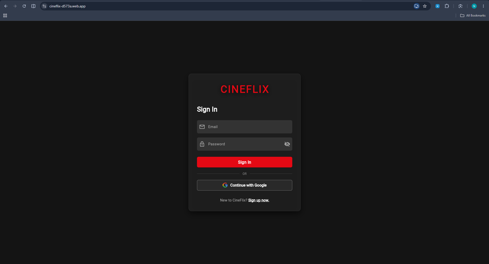
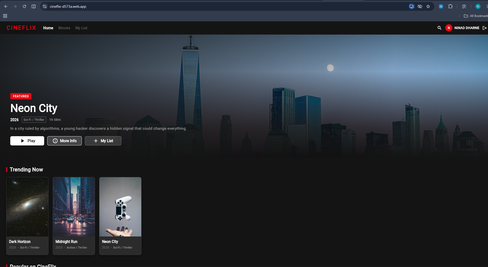
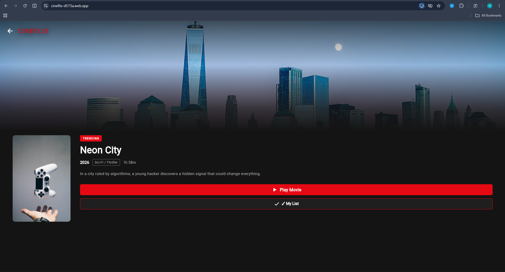
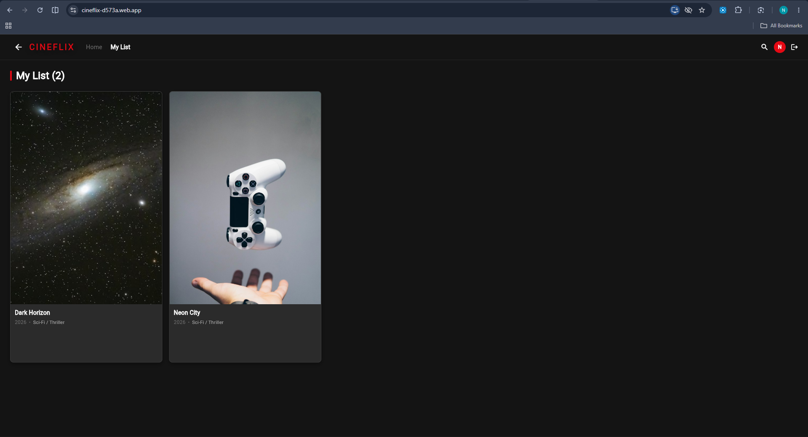

# 🎬 CineFlix — OTT Movie Streaming Application

A cross-platform OTT movie streaming application built with **Flutter, Dart, and Firebase**. CineFlix provides a modern streaming-style interface for discovering movies, watching available videos, and maintaining a personalized watchlist.

🌐 **Live Demo:** [cineflix-d573a.web.app](https://cineflix-d573a.web.app)

📦 **Source Code:** [GitHub Repository](https://github.com/Ninad-0876/CineFlix)

---

## ✨ Features

- **User Authentication:** Register and sign in using email and password, with Google Sign-In integration.
- **Movie Discovery:** Browse featured movies and movie collections through a streaming-style home screen.
- **Movie Details:** View information and descriptions for selected movies.
- **Video Playback:** Play available sample videos using an integrated video player with playback controls.
- **Smart Search:** Search for movies using titles, genres, release years, and descriptions.
- **My List:** Save movies to a personalized watchlist associated with the authenticated user.
- **Profile Management:** Update your display name and manage your account session.
- **Responsive UI:** Designed to adapt to web browsers and Android devices.
- **Cloud Integration:** Use Firebase services for authentication and cloud-based data storage.

## 🛠️ Tech Stack

| Technology | Purpose |
|---|---|
| Flutter | Cross-platform UI development |
| Dart | Application programming language |
| Firebase Authentication | User authentication |
| Cloud Firestore | Movie data and user watchlists |
| Firebase Hosting | Web application deployment |
| Git and GitHub | Version control and source-code hosting |

## 🖥️ Application Preview

## 🖥️ Application Screenshots

### Login Screen


### Home Screen


### Movie Details


### My List

## 🚀 Getting Started

### Prerequisites

- Flutter SDK
- Dart SDK (included with Flutter)
- Git
- A Firebase project
- Android Studio or Visual Studio Code

### 1. Clone the repository

```bash
git clone https://github.com/Ninad-0876/CineFlix.git
cd CineFlix
```

### 2. Install dependencies

```bash
flutter pub get
```

### 3. Configure Firebase

Configure Firebase for your own project using the FlutterFire CLI or the official Firebase setup instructions.

Ensure the required Firebase configuration files and platform settings are present. Enable the authentication providers you intend to use and configure Firestore security rules appropriately.

### 4. Run the application

For the web:

```bash
flutter run -d chrome
```

For a connected Android device:

```bash
flutter run
```

### 5. Build a release APK

```bash
flutter build apk --release
```

The APK is generated at:

`build/app/outputs/flutter-apk/app-release.apk`

## 🔐 Security Notes

- Never commit service-account private keys, passwords, signing keys, or other private credentials.
- Configure Firestore security rules to restrict user-specific data to its owner.
- Review Firebase Authentication and authorized-domain settings before deployment.
- Use your own Firebase configuration when running a separate instance of this project.

## 🗺️ Future Enhancements

- Personalized movie recommendations
- Watch history and continue-watching functionality
- Improved content categorization
- Administrative movie management
- Additional authentication and playback improvements

## 🎓 Project Purpose

CineFlix was developed as a cross-platform application project to demonstrate Flutter UI development, Firebase Authentication, cloud database integration, media playback, and user-specific data management.

The current version uses a demonstration movie catalogue and sample video sources. It is an educational prototype rather than a commercial streaming service.

## 👨‍💻 Author

**Ninad Dharne**

- GitHub: [@Ninad-0876](https://github.com/Ninad-0876)
- Project: [CineFlix](https://github.com/Ninad-0876/CineFlix)
- Live Demo: [CineFlix Web App](https://cineflix-d573a.web.app)

---

If you find this project useful, consider giving the repository a ⭐ on GitHub.